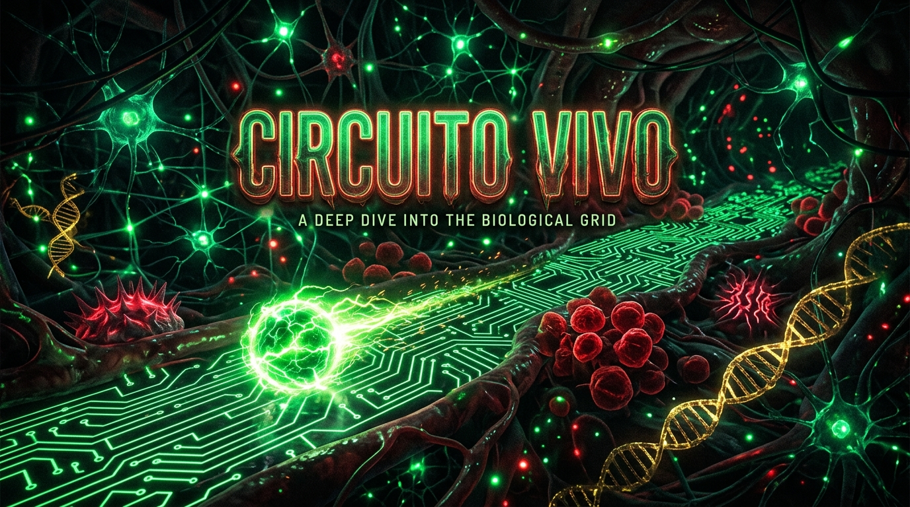

# 🧬 Circuito Vivo

<p align="center">
  <a href="https://github.com/leonardoconstantino/circuito-vivo/actions/workflows/deploy.yml">
    
  </a>
  
  
  
  
  
</p>

<p align="center">
  <strong>Um arcade de puzzle e velocidade biopunk em perspectiva pseudo-3D</strong><br />
  Inspirado no clássico minigame <em>Blue Sphere</em> de Sonic 3, reimaginado dentro de um organismo vivo biomecânico.
</p>

<p align="center">
  <a href="https://leonardoconstantino.github.io/circuito-vivo/">
    
  </a>
</p>

---

## 🖼️ Visão Geral

<p align="center">
  
</p>

**Circuito Vivo** coloca você no controle de um impulso bioelétrico (*O Sinal*) propagando-se em alta velocidade pela malha neural de um córtex biossintético. O objetivo é sincronizar todos os **Nós Sinápticos** espalhados pelo mapa cilíndrico e coletar filamentos de RNA enquanto desvia ou salta sobre **Células Cancerígenas** hiperativas.

A física do jogo opera sobre uma grade toroidal 32×32 onde as bordas se conectam continuamente, criando um looping infinito de raciocínio espacial e reflexos rápidos.

---

## ✨ Principais Recursos

- **Perspectiva Pseudo-3D em Tempo Real**: Renderização proprietária em Canvas 2D a 60 FPS com projeção de horizonte esférico, linhas de grade curvadas e iluminação dinâmica.
- **Mecânica Clássica de Anéis (*Ring Clear*)**: Ao contornar e fechar o perímetro de um bloco de nós sinápticos verdes, todos os nós internos são convertidos instantaneamente em filamentos de RNA dourados de alta pontuação.
- **Salto Neural com Sombra Projetada**: Habilidade de saltar sobre o grid para transpor anomalias tumorais sem quebrar o ritmo ou a linha de raciocínio.
- **Áudio Sintetizado Procedural (Web Audio API)**: Zero dependência de arquivos MP3 externos. Todos os bips, pulsos de sonar, sintetizadores de ritmo e efeitos de impacto são gerados matematicamente em tempo real via osciladores senoidais e filtros analógicos virtuais.
- **Diagnósticos & Telemetria em Tempo Real**: Painel com monitoramento de integridade da membrana, frequência de pulso cardíaco (BPM), nós restantes e contador de loops.
- **Design 100% Responsivo e Otimizado para Mobile**: Controles táteis na tela para viradas e salto em modo tela cheia no smartphone, além de suporte fluído a teclado e gamepad em telas desktop.
- **Offline-First & Zero Configurações Externas**: Funciona 100% no navegador sem necessidade de banco de dados ou backend para o loop de jogo principal.

---

## 🧬 Elementos Biológicos do Circuito

| Elemento | Visual | Função no Sistema |
| :--- | :---: | :--- |
| **Nó Sináptico** | 🟢 Esfera Verde Pulsante | Objetivo primordial. Deve ser tocado para ativar a sinapse. Ao ser coletado, converte-se em um anel inativo. |
| **Filamento de RNA** | 🟡 Dupla Hélice Dourada | Item de alta energia. Multiplica a pontuação e restaura a estabilidade sináptica da rede. |
| **Célula Cancerígena** | 🔴 Anomalia Vermelha | Mutação agressiva com filamentos táteis. Tocar no chão causa colapso do sinal (Game Over). Pode ser evitada com saltos precisos. |
| **Nó Latente** | ⚪ Esfera Escura / Vermelha | Nó já ativado ou desvitalizado. Atua como barreira estéril no circuito. |

---

## 🎮 Controles

### 💻 Teclado (Desktop)

| Tecla | Ação |
| :--- | :--- |
| <kbd>←</kbd> ou <kbd>A</kbd> | Virar 90° para a Esquerda |
| <kbd>→</kbd> ou <kbd>D</kbd> | Virar 90° para a Direita |
| <kbd>Espaço</kbd> ou <kbd>↑</kbd> | Salto Neural (Pular sobre células tumorais) |
| <kbd>P</kbd> ou <kbd>Esc</kbd> | Pausar / Continuar |
| <kbd>R</kbd> | Reiniciar o circuito atual |

### 📱 Dispositivos Móveis (Touch)

- **Botão Esquerdo (↶)**: Virar à esquerda
- **Botão Direito (↷)**: Virar à direita
- **Botão Central Superior (▲)**: Executar Salto Neural
- **Botão Topo Direito (⏸)**: Acessar menu de pausa / diagnósticos

---

## 🚀 Como Executar Localmente

Certifique-se de ter o **Node.js 20+** instalado em seu sistema.

```bash
# 1. Clone o repositório
git clone https://github.com/leonardoconstantino/circuito-vivo.git

# 2. Acesse a pasta do projeto
cd circuito-vivo

# 3. Instale as dependências
npm install

# 4. Inicie o servidor de desenvolvimento
npm run dev
```

Abra seu navegador em `http://localhost:3000` para começar a jogar.

### Comandos Adicionais

```bash
# Executar a checagem de tipos (TypeScript linter)
npm run lint

# Gerar a build de produção otimizada
npm run build

# Pré-visualizar a build localmente
npm run preview
```

---

## ⚙️ Deploy Automático (GitHub Actions)

O repositório já está configurado com um fluxo contínuo de integração e entrega (CI/CD) localizado em `.github/workflows/deploy.yml`:

1. Qualquer **push** na branch `main` ou `master` aciona o workflow.
2. O runner em `ubuntu-latest` utiliza o Node.js 20 para compilar o projeto com o caminho base correto (`/circuito-vivo/`).
3. Os artefatos estáticos da pasta `dist/` são validados e publicados diretamente no **GitHub Pages**.
4. O workflow também pode ser disparado manualmente através da aba **Actions** (`workflow_dispatch`).

---

## 🛠️ Tecnologias Utilizadas

- **[React 19](https://react.dev/)** — Gerenciamento de estado reativo, hooks de ciclo de vida e overlays de UI.
- **[TypeScript 5.8](https://www.typescriptlang.org/)** — Tipagem estrita de matrizes toroidais, renderização e áudio.
- **[Vite 6](https://vitejs.dev/)** — Bundler moderno ultrarrápido com Hot Module Replacement.
- **[Tailwind CSS v4](https://tailwindcss.com/)** — Estilização bio-tech cyberpunk com microinterações fluidas.
- **[Lucide React](https://lucide.dev/)** — Ícones médicos, bioelétricos e de navegação.
- **Web Audio API** — Síntese analógica procedural em tempo real.
- **HTML5 Canvas** — Motor de rasterização pseudo-3D a 60 FPS com cálculos trigonométricos de horizonte.

---

## 📄 Licença

Distribuído sob a licença **MIT**. Consulte o arquivo `LICENSE` para mais informações.

Desenvolvido com carinho e precisão bioelétrica por **[Leonardo Constantino](https://github.com/leonardoconstantino)**.  
Contato: `leohconstantino@gmail.com`
